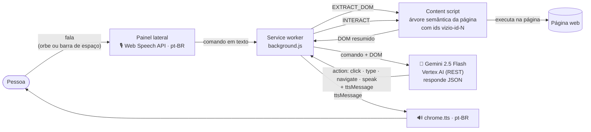

# VIZIO AI

Extensão do Chrome que permite navegar na web por voz, guiada por IA: a pessoa diz o que quer, o Gemini interpreta a página e executa a ação, narrando tudo em áudio. Foi pensada para pessoas cegas.

<!-- DEMO -->

## O problema

Para quem não enxerga a tela, navegar na web com leitor de tela e atalhos de teclado é lento e exige decorar muitos comandos. O VIZIO AI explora outra abordagem: em vez de percorrer a página elemento por elemento, a pessoa fala um comando ("pesquisa por bola", "volta para a página anterior") e um agente de IA decide o que fazer na página e descreve o resultado em voz.

## Como funciona

A pessoa abre o painel lateral da extensão e fala (clique no orbe ou barra de espaço). A fala vira texto, o content script extrai uma árvore semântica da página, e o Gemini devolve **uma ação em JSON**, que o content script executa na página. Cada passo é narrado por voz.

Pontos de IA no código:

- **LLM:** `src/background/background.js` envia o comando e o DOM resumido ao Gemini 2.5 Flash via a API REST do Vertex AI (`src/utils/genai.js`, uma camada mínima em JS puro, sem build). O prompt de sistema instrui o modelo a priorizar a semântica da página, narrar antes e depois de agir, numerar elementos ambíguos e pedir confirmação em ações críticas.
- **Ações estruturadas, não tool calling nativo:** o modelo responde com um JSON (`click`, `type`, `navigate`, `speak`, `targetId`, `ttsMessage`) que o código interpreta. O projeto não usa a API de function calling nem MCP.
- **Voz:** reconhecimento de fala pela Web Speech API do Chrome (pt-BR) e síntese com `chrome.tts`. A aba ativa é silenciada durante o comando para não gerar eco.
- **Extração da página:** `src/content/content.js` percorre elementos interativos e regiões (links, botões, campos, `role`, `aria-label`, cabeçalhos) e atribui ids estáveis (`vizio-id-N`) usados para clicar e digitar.

## O que é protótipo

- **Não há ativação por palavra-chave.** A ideia "OK, VIZIO" estava no escopo do MVP (`documents-mvp/`), mas não está no código: hoje a escuta começa pelo orbe ou pela barra de espaço do painel lateral.
- A confirmação em ações críticas (pagar, apagar, enviar) é uma instrução no prompt do modelo, não uma trava no código.
- Sem testes automatizados e sem avaliação com usuários. A hipótese do MVP (chegar ao conteúdo 3x mais rápido que com TAB e leitor de tela) **não foi validada**.
- Não atua em páginas internas do navegador (`chrome://` e similares).

## Stack

- Extensão Chrome (Manifest V3), JavaScript puro, painel lateral
- Gemini 2.5 Flash via Vertex AI (REST)
- Web Speech API (reconhecimento) e `chrome.tts` (síntese)

## Meu papel

Desenvolvi a extensão: service worker e integração com o Gemini, extração do DOM e execução das ações na página, painel lateral e fluxo de voz, além dos documentos de produto do MVP (`documents-mvp/`). Leonardo Miranda Nunciaroni contribuiu com as permissões de voz e ajustes no painel.

## Contexto

Projeto do hackathon **AI Tinkerers & Google DeepMind: AI for Social Impact**, em 11 e 12/04/2026. Sem colocação.

## Como rodar localmente

Requisitos: Google Chrome e um projeto no Google Cloud com a Vertex AI habilitada e uma API key restrita à Vertex AI API.

1. Clone o repositório.
2. Copie `extension/src/utils/config.example.js` para `extension/src/utils/config.js` e preencha `PROJECT_ID`, `LOCATION`, `API_KEY` e `MODEL_NAME` (padrão `gemini-2.5-flash`).
3. Abra `chrome://extensions`, ative o **Modo do desenvolvedor**, clique em **Carregar sem compactação** e selecione a pasta `extension/`.
4. Clique no ícone da extensão para abrir o painel lateral, autorize o microfone e fale um comando em português.

> **Atenção com a chave:** o `config.js` está no `.gitignore` e não é versionado; só o `config.example.js` (sem chave) está no repositório. Nunca publique a API key; se ela vazar, revogue-a no Google Cloud. Se você já tinha um clone com o `config.js` preenchido, guarde uma cópia dele antes de atualizar.

Não há etapa de build nem testes automatizados.
